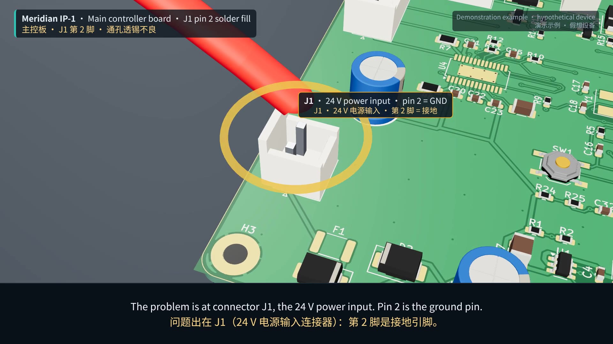
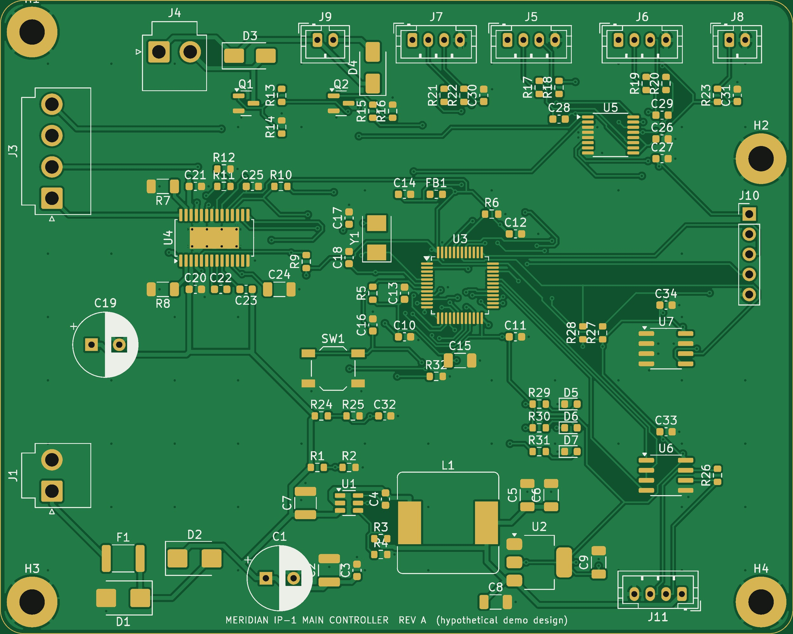

# Meridian IP-1

A made-up surgical irrigation pump, designed down to a routed four-layer controller board, and a two-minute video in English and Mandarin that shows a board assembler one solder defect and exactly how to fix it.

**See it:** https://bbelllabs.com/work/meridian-ip1 (both videos, a 3D model you can turn and open, and the board record)

Everything here is a made-up example. "Meridian IP-1" is not a real product and no third-party design data was used. The package was produced with an AI-assisted pipeline that I directed.

## What is in this repository
- `video/meridian_ip1_j1_solder_fill_EN.mp4` — English narration, English + Chinese subtitles burnt in
- `video/meridian_ip1_j1_solder_fill_ZH.mp4` — Mandarin narration, same picture and subtitles
- `video/*.srt` — the subtitle text as separate files
- `cad/meridian_ip1.step` — full device assembly (enclosure, pump head, stepper + gearbox, pinch valve, sensors, fan, display, harnesses, board)
- `cad/meridian_ip1_mech.glb`, `cad/ip1_main_board.glb` — the same models for 3D viewers
- `cad/device.py` — the parametric CAD source (CadQuery)
- `pcb/ip1_main.kicad_pcb` — the routed 4-layer board (KiCad 7)
- `pcb/ip1_main.step` — board with component models
- `pcb/fab/` — Gerbers, drill file, placement file, parts list (BOM), netlist
- `pcb/board_def.py`, `pcb/make_board.py`, `pcb/patch_dsn.py` — the board source: parts, placement, netlist, build steps
- `pcb/ip1_main_drc.txt` — KiCad design-rule report

## The board
100 x 80 mm, 1.6 mm, 4 layers (signal + ground pour / ground plane / 3.3 V plane / signal + ground pour). 97 parts, 72 nets.
STM32F103 microcontroller; TMC2226 stepper driver (pump motor, J3); ADS1220 24-bit converter for two bridge pressure sensors (J5, J6);
optical bubble sensor input (J7); motor temperature input (J8); MOSFET switches with flyback diodes for the pinch valve (J4) and fan (J9);
24 V input with fuse, surge clamp and reverse-polarity diode (J1); 24 V to 5 V switching regulator; 3.3 V linear regulator;
RS-485 link to the display board (J11); EEPROM for calibration; debug header (J10).

Rev A detail the video is built on: J1 pin 2 (ground) joins the ground copper on layers 1, 2 and 4 with no thermal-relief spokes.

## Checked
- Netlist against footprints: every pad exists, no pad on two nets, deliberate no-connects listed.
- KiCad design-rule check on the finished board: 0 shorts, 0 clearance errors, 0 unconnected items.
  The 146 remaining items are 45 silkscreen label overlaps and 101 "footprint not linked to a library" notes; none are electrical.
- No overlapping parts; all parts inside the outline. Gerber, drill and placement files export.

## Not checked
- The board has not been built, powered or simulated.
- Component values come from data-sheet typical circuits and were not tuned.
- There is no drawn schematic; the circuit is the netlist table in `board_def.py`.
- Routing is from an autorouter (freerouting 1.9) plus scripted plane vias. No human review for noise, heat, creepage or medical safety spacing.
- The KiCad library has no 3D model for the 3.96 mm headers (J1, J3, J4); simple models of them are in the device assembly, not in `ip1_main.step`.
- Mechanical parts are simplified shapes at true size.

## Facts used in the video (with where they come from)
- Minimum 75% vertical solder fill of a plated through-hole for Class 3: IPC J-STD-001 / IPC-A-610.
- Cause on plane-connected pins: heat sinking into the copper planes. Fixes: more top-side preheat (hole copper at 110 C or more before the wave),
  longer contact time, flux through the full hole, and thermal-relief pads in the design.
- Fill must be verified by X-ray or cross-section because the connector body hides the top side.
- The "about 40% fill" figure is an illustration for this made-up case, not a measurement.

## Narration
Computer-generated voices (Piper: en_US "ryan", zh_CN "huayan"). The Chinese wording and factory terms (透锡, 波峰焊, 链速, 花焊盘) should get a native-speaker check before this is used with a real supplier.
